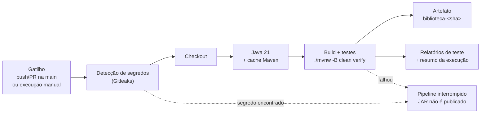
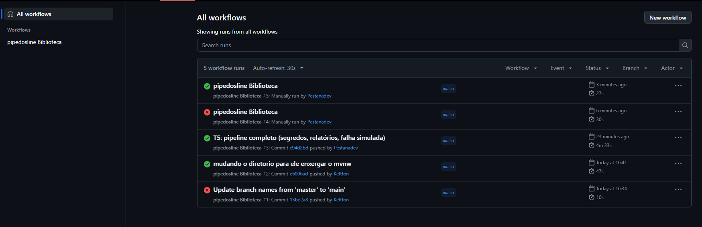
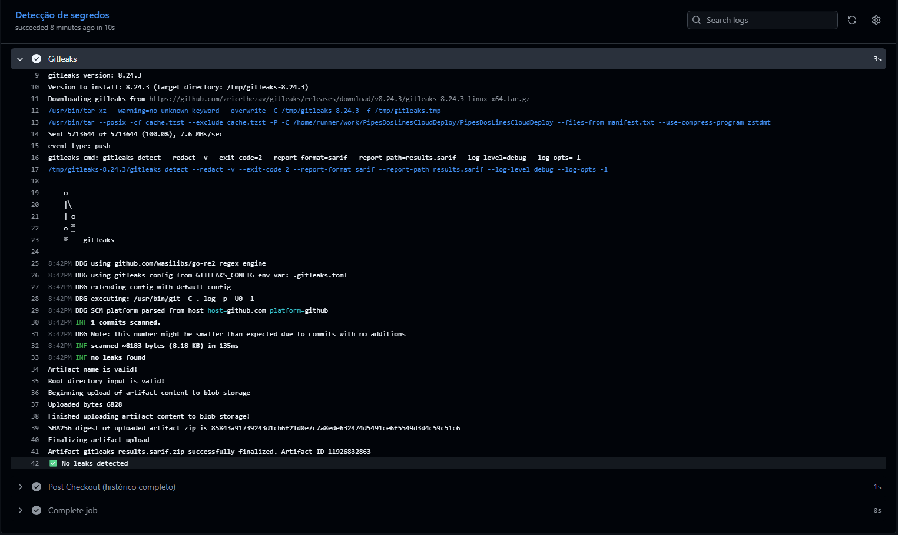
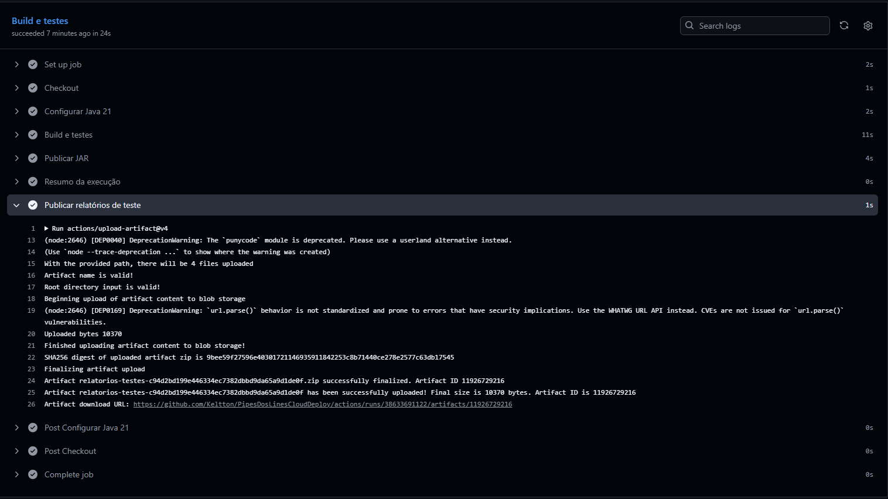
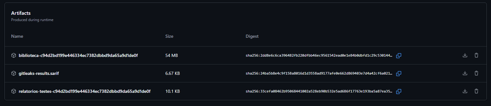

# T5 — Pipeline CI mínimo e reprodutível

**Disciplina:** Cloud Computing e DevOps Avançado
**Aplicação:** Biblioteca (Spring Boot / Java 21 / Maven)
**Ferramenta:** GitHub Actions
**Equipe:** Keltton, Felipe, Daniel
**Repositório:** https://github.com/Keltton/PipesDosLinesCloudDeploy

---

## Comece aqui: testar o pipeline no GitHub (passo a passo)

Não é preciso instalar nada: tudo acontece no navegador, em cerca de 10 minutos. O GitHub está em inglês, então os botões aparecem **em negrito**, escritos como estão na tela.

### Passo 1: entrar no GitHub
1. Acesse https://github.com e clique em **Sign in**. Quem não tem conta clica em **Sign up** e cria uma, de graça.

### Passo 2: fazer a sua cópia do repositório (fork)
O *fork* cria uma cópia na sua conta. Nela você pode rodar o pipeline à vontade, sem mexer no original.
1. Abra https://github.com/Keltton/PipesDosLinesCloudDeploy
2. No canto superior direito, clique em **Fork**.
3. Na tela seguinte, não mude nada e clique em **Create fork**.
4. O GitHub abre `https://github.com/<seu-usuario>/PipesDosLinesCloudDeploy`. **Daqui em diante, trabalhe nessa cópia.**

### Passo 3: ligar o GitHub Actions na sua cópia
Por segurança, o GitHub deixa os pipelines **desligados** em todo fork novo.
1. Na sua cópia, clique na aba **Actions**, na barra de cima.
2. Clique no botão verde **I understand my workflows, go ahead and enable them**.

### Passo 4: rodar o pipeline
1. Ainda em **Actions**, clique em **pipedosline Biblioteca** na lista da esquerda.
2. À direita, clique no botão **Run workflow**.
3. Na caixa que abre, deixe *Branch: main* e a opção **Simular falha de teste** **desmarcada**.
4. Clique no botão verde **Run workflow**.
5. Em alguns segundos aparece uma linha nova com um círculo amarelo 🟡 (rodando). Se não aparecer, atualize a página (**F5**).

### Passo 5: ver o resultado (cerca de 2 minutos)
1. Quando o círculo virar ✅, clique no nome da execução.
2. Aparecem dois blocos, **Detecção de segredos** e **Build e testes**, os dois com ✅.
3. Role a página: o **Resumo da execução** mostra o commit e o relatório dos testes.
4. No fim da página, em **Artifacts**, clique em `biblioteca-<código>` para baixar um `.zip` com o **JAR** da aplicação. Esse arquivo é o produto do pipeline.

### Passo 6: ver o pipeline barrando um erro
1. Repita o Passo 4, mas agora **marque** a opção **Simular falha de teste**.
2. A execução termina com ❌. Clique nela e depois no bloco **Build e testes**.
3. Abra a etapa **Build e testes** marcada com ❌ e procure a mensagem `Falha proposital solicitada para evidência do T5`.
4. Confira em **Artifacts**: **não há JAR**, só os relatórios de teste. Isso prova que código com erro não vira artefato.
5. Rode mais uma vez **sem** marcar a opção. A execução volta a ficar ✅ (recuperação).

### Passo 7 (opcional): disparar o pipeline com uma alteração
1. Na aba **Code** da sua cópia, clique no arquivo `README.md` e depois no lápis ✏️ (**Edit this file**).
2. Mude qualquer palavra e clique em **Commit changes...** e depois em **Commit changes**.
3. Volte em **Actions**: uma execução começou sozinha, disparada pelo `push`.

### Problemas comuns

| O que aparece | O que fazer |
|---|---|
| Em **Actions**: *"Workflows aren't being run on this forked repository"* | Faltou o Passo 3: clique em **I understand my workflows, go ahead and enable them** |
| O botão **Run workflow** não aparece | Clique antes em **pipedosline Biblioteca**, na lista da esquerda. O botão só aparece na **sua cópia**, não no repositório original |
| A execução fica parada em 🟡 *Queued* | É a fila do GitHub. Aguarde 1 a 2 minutos |
| **Artifacts** vazio numa execução antiga | Os arquivos são apagados depois de 14 dias. Rode de novo |
| ❌ sem ter marcado a simulação | Abra o bloco vermelho e a etapa com ❌. A seção 6 explica como investigar |

---

## Pré-requisitos para rodar

### O que cada trabalho precisa

| Para rodar | Pré-requisitos |
|---|---|
| **T5** (este pipeline) | Só uma conta no GitHub (ver *Comece aqui*). Nenhum secret a configurar. Para rodar no próprio computador: Java 21 (o `mvnw` baixa o Maven sozinho) |
| **T6** (deploy blue/green, [`T6-CD.md`](T6-CD.md)) | Docker Desktop com Kubernetes ligado no modo **kubeadm** (ver abaixo) e, no Windows, o **Git Bash** para rodar os scripts. Publicar a imagem no GHCR só é necessário para um cluster na nuvem |
| **T7** (observabilidade, [`T7-OBSERVABILIDADE.md`](T7-OBSERVABILIDADE.md)) | Docker Desktop (já vem com o Compose) e a variável `API_SECURITY_TOKEN_SECRET` definida antes do `docker compose up` |

### T6 no próprio computador (Kubernetes do Docker Desktop)
1. Abra o Docker Desktop e vá em **Settings → Kubernetes**. Marque **Enable Kubernetes**.
2. Em **Cluster provisioning method**, escolha **kubeadm** e clique em **Apply & restart**. Aguarde o ícone do Kubernetes ficar verde.
   No modo *kind*, o cluster não enxerga as imagens construídas no computador. Ele tenta baixá-las do GHCR, e o pod falha com `error from registry: denied`.
3. No Git Bash, na pasta do repositório:
```bash
kubectl config use-context docker-desktop
docker build -t ghcr.io/keltton/biblioteca:v1 biblioteca-master
docker tag ghcr.io/keltton/biblioteca:v1 ghcr.io/keltton/biblioteca:v2
kubectl create secret generic biblioteca-secret --from-literal=jwt-secret="$(openssl rand -base64 48)"
kubectl apply -f k8s/
./scripts/deploy-bluegreen.sh v1      # liga a green
./scripts/deploy-bluegreen.sh v2      # troca para a blue
./scripts/rollback.sh                 # volta para a green
./scripts/finalizar.sh                # desliga a cor antiga
kubectl delete -f k8s/                # limpa tudo ao terminar
```
Nesse modo local **não é preciso trocar `keltton`** nem publicar a imagem: o cluster usa a imagem construída no próprio computador.

**Sobre o smoke test:** `GET /api/livros` é aprovado com **200 ou 404**, porque a API responde 404 enquanto não há livros cadastrados. O que reprova é **401 ou 403**, que significam JWT recusado, ou um erro **5xx**.

### Publicar a imagem no GHCR (só para cluster na nuvem)
1. Crie um token: GitHub → foto do perfil → **Settings → Developer settings → Personal access tokens → Tokens (classic) → Generate new token (classic)**. Marque **`write:packages`** e clique em **Generate token**. Copie o token, porque ele aparece uma única vez.
   Use o tipo **classic**. Com um token *fine-grained*, o `docker push` envia as camadas e termina com `error from registry: denied`.
2. Faça login e publique:
```bash
echo "SEU_TOKEN" | docker login ghcr.io -u <seu-usuario> --password-stdin
SHA=$(git rev-parse --short HEAD)
docker build -t ghcr.io/<seu-usuario>/biblioteca:$SHA biblioteca-master
docker push ghcr.io/<seu-usuario>/biblioteca:$SHA
```
3. Para o cluster baixar sem senha, deixe o pacote público: perfil → **Packages → biblioteca → Package settings → Change visibility → Public**.

### Fork: trocar o dono da imagem (só ao publicar no GHCR)
A imagem é publicada no GHCR **em nome do dono do repositório**, e neste repositório o dono é `keltton`. Num fork, o push para `ghcr.io/keltton/...` é negado. Troque pelo **seu usuário do GitHub, em minúsculas** (o GHCR não aceita maiúsculas):

| Arquivo | Onde aparece |
|---|---|
| `k8s/deployment-blue.yaml` | `image: ghcr.io/keltton/biblioteca:TAG` |
| `k8s/deployment-green.yaml` | `image: ghcr.io/keltton/biblioteca:TAG` |
| `scripts/deploy-bluegreen.sh` | valor padrão de `IMAGE_REPO` |
| `T6-CD.md` (seção 1.1) | `docker login`, `docker build` e `docker push` |

```bash
USUARIO=seu-usuario   # em minúsculas
sed -i "s|ghcr.io/keltton/|ghcr.io/$USUARIO/|g; s|-u keltton |-u $USUARIO |" \
  k8s/deployment-*.yaml scripts/deploy-bluegreen.sh T6-CD.md
```

Sem editar arquivos, também funciona assim: `IMAGE_REPO=ghcr.io/<usuario>/biblioteca ./scripts/deploy-bluegreen.sh <sha>`.

O pipeline do T5 **não** precisa dessa troca: ele não publica imagem e usa o `GITHUB_TOKEN` automático.

---

## 1. Visão geral



Arquivo do pipeline: [`.github/workflows/pipedosline.yml`](.github/workflows/pipedosline.yml)
A aplicação fica em `biblioteca-master/` (usada como `working-directory`).

## 2. Definição

| Item | Definição |
|---|---|
| **Gatilho** | `push` na `main`, `pull_request` para a `main` e `workflow_dispatch` (execução manual, com opção de simular falha) |
| **Ambiente** | `ubuntu-latest`, máquina nova e limpa a cada execução |
| **Dependências** | Java 21 (Temurin), Maven Wrapper (`mvnw`) com cache do Maven; actions `checkout@v4`, `setup-java@v4`, `upload-artifact@v4`, `gitleaks-action@v2` |
| **Artefato** | JAR publicado como `biblioteca-<sha do commit>` (retenção de 14 dias) |
| **Evidências geradas** | Log de cada etapa, resumo da execução (Job Summary) e relatórios do Surefire (`relatorios-testes-<sha>`) |
| **Permissões** | `contents: read` e `pull-requests: read` (somente leitura) |

## 3. Etapas

| # | Job | Etapa | Ação | Saída | Falha quando |
|---|---|---|---|---|---|
| 1 | secrets-scan | Gitleaks | Varre os commits do push ou Pull Request em busca de segredos | Resultado do scan (`gitleaks-results.sarif`) | Segredo detectado |
| 2 | build | Checkout | Baixa o código do commit | Código-fonte | Repositório inacessível |
| 3 | build | Configurar Java 21 | Instala o JDK e restaura o cache do Maven | Ambiente pronto | Versão indisponível |
| 4 | build | Build e testes | `./mvnw -B clean verify`: compila, testa e empacota | `target/*.jar` | Erro de compilação ou teste reprovado |
| 5 | build | Publicar JAR | Envia o JAR para *Artifacts* | `biblioteca-<sha>` | JAR não encontrado |
| 6 | build | Resumo da execução | Escreve commit, gatilho, run e resultado dos testes no Job Summary (sempre executa) | Resumo na página do run | — |
| 7 | build | Publicar relatórios de teste | Envia `surefire-reports` (sempre executa) | `relatorios-testes-<sha>` | — |

O job `build` depende do `secrets-scan` (`needs`): se a etapa 1 encontrar um segredo, o build nem começa. Se a etapa 4 falhar, a etapa 5 não é executada e nenhum JAR é publicado; as etapas 6 e 7 ainda rodam para preservar a evidência.

**Testes existentes:**
- `BibliotecaApplicationTests.contextLoads()` — sobe o contexto Spring.
- `PipelineFalhaSimuladaTest` — passa normalmente; falha apenas quando a execução manual é feita com a opção **simular_falha** marcada (`-Dsimular.falha=true`). Serve para demonstrar a detecção de falha sem alterar o código.

## 4. Como reproduzir

**No GitHub:** siga o [Comece aqui](#comece-aqui-testar-o-pipeline-no-github-passo-a-passo), no topo deste README.

**No próprio computador** (precisa do Java 21; no Windows, use o Git Bash):
```bash
git clone https://github.com/<seu-usuario>/PipesDosLinesCloudDeploy.git
cd PipesDosLinesCloudDeploy/biblioteca-master
./mvnw -B clean verify                        # esperado: BUILD SUCCESS
ls target/*.jar
./mvnw -B clean verify -Dsimular.falha=true   # esperado: BUILD FAILURE
```

## 5. Evidências

### 5.0 Histórico das execuções

| Run | Gatilho | Resultado | Duração |
|---|---|---|---|
| #3 | `push` na `main` (commit `c94d2bd`) | ✅ Sucesso | 4m33s |
| #4 | Manual, com `simular_falha` marcada | ❌ Falha detectada | 30s |
| #5 | Manual, sem `simular_falha` | ✅ Recuperação | 27s |



### 5.1 Execução bem-sucedida (Run #3)

- Link: https://github.com/Keltton/PipesDosLinesCloudDeploy/actions/runs/38633691122
- Commit: `c94d2bd199e446334ec7382dbbd9da65a9d1de0f` — Gatilho: `push` na `main`


*Os dois jobs, **Detecção de segredos** e **Build e testes**, concluídos com sucesso.*


*Log de "Build e testes": `Tests run: 2, Failures: 0, Errors: 0`, JAR `biblioteca-0.0.1-SNAPSHOT.jar` gerado e `BUILD SUCCESS`.*


*Gitleaks: `no leaks found` e `No leaks detected`.*


*Upload do artefato `relatorios-testes-<sha>` (10370 bytes) ao final do job.*

### 5.2 Falha detectada (Run #4)

- Link: `COLAR_URL_DO_RUN_4`
- Cenário: execução manual (**Run workflow**) com a opção `simular_falha` marcada.


*O teste `PipelineFalhaSimuladaTest.falhaSomenteQuandoSolicitada` reprovou (`Tests run: 2, Failures: 1`), o Maven terminou com `BUILD FAILURE` e a etapa **Publicar JAR** foi ignorada (*skipped*). As etapas "Resumo da execução" e "Publicar relatórios de teste" ainda executaram.*


*Página do run: **Build e testes** em ❌ e **Detecção de segredos** em ✅. Em **Artifacts** existem apenas `gitleaks-results.sarif` e `relatorios-testes-<sha>`: nenhum JAR foi publicado.*

### 5.3 Recuperação (Run #5)

- Link: `COLAR_URL_DO_RUN_5`
- Cenário: nova execução manual, sem marcar `simular_falha`, sobre o mesmo commit `c94d2bd`.


*Pipeline verde novamente, com o JAR `biblioteca-<sha>` (54 MB) e os relatórios publicados.*

## 6. Como investigar falhas

1. Abrir **Actions** e localizar a execução com ❌.
2. Abrir o job que falhou e expandir a etapa vermelha.
3. Em falha de teste, procurar no log por `Tests run:` e `FAILURE` para achar a classe e o método (ex.: `PipelineFalhaSimuladaTest...:16`).
4. Conferir o **Resumo da execução** (topo da página do run) e baixar `relatorios-testes-<sha>` em Artifacts.
5. Reproduzir localmente: `cd biblioteca-master && ./mvnw -B clean verify`.
6. Corrigir, fazer novo push e confirmar que o pipeline volta a ficar verde.

## 7. Como os segredos são protegidos

- O pipeline roda com permissões somente leitura e não usa tokens de deploy.
- Segredos de pipeline, quando necessários, ficam em **Settings → Secrets and variables → Actions** e são lidos com `${{ secrets.NOME }}`; o GitHub mascara os valores nos logs.
- O job **Detecção de segredos** (Gitleaks) varre os commits de cada push ou Pull Request. Se encontrar credenciais, o pipeline é reprovado e o job de build nem começa (`needs: secrets-scan`), então nenhum JAR é publicado.
- O valor de `api.security.token.secret` em `application.properties` é apenas de desenvolvimento (banco H2 em memória) e está explicitamente liberado em `.gitleaks.toml`. Em ambiente real ele deve ser sobrescrito pela variável de ambiente `API_SECURITY_TOKEN_SECRET`.
- O Maven Wrapper (`mvnw`) garante a mesma versão do Maven em qualquer máquina.

## 8. Observações

- Os logs exibem avisos do GitHub (Node.js 20 em desuso nas actions, `setup-java@v4` com migração sugerida para `v5` e mudança do `ubuntu-latest` para Ubuntu 26 em 19/10/2026). Eles não afetam o resultado do pipeline e podem ser tratados em uma próxima iteração.
- Os runs #1 e #2 são anteriores a esta entrega (ajuste de branch e do diretório do `mvnw`) e não fazem parte das evidências.
