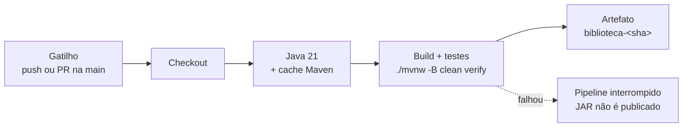

# T5 — Pipeline CI mínimo e reprodutível

**Disciplina:** Cloud Computing e DevOps Avançado 
**Aplicação:** Biblioteca 
**Ferramenta:** GitHub Actions
**Equipe:** Keltton, Felipe, Daniel

---

## 1. Visão geral



Arquivo do pipeline: `.github/workflows/ci.yml`

## 2. Definição

| Item | Definição |
|---|---|
| **Gatilho** | `push` e `pull_request` na branch `master` |
| **Ambiente** | `ubuntu-latest`, máquina nova e limpa a cada execução |
| **Dependências** | Java 21 (Temurin) e Maven Wrapper (`mvnw`), com cache das dependências |
| **Artefato** | JAR da aplicação, publicado como `biblioteca-<sha do commit>` |
| **Permissões** | `contents: read` (somente leitura) |

## 3. Etapas

| # | Etapa | Ação | Saída | Falha quando |
|---|---|---|---|---|
| 1 | Checkout | Baixa o código do commit que disparou a execução | Código-fonte | Repositório inacessível |
| 2 | Configurar Java 21 | Instala o JDK Temurin 21 e restaura o cache do Maven | Ambiente pronto | Versão indisponível |
| 3 | Build e testes | `./mvnw -B clean verify`: compila, executa os testes e empacota | `target/*.jar` | Erro de compilação ou teste reprovado |
| 4 | Publicar JAR | Envia o JAR para a aba *Artifacts* | `biblioteca-<sha>` | JAR não encontrado |

Se a etapa 3 falhar, a etapa 4 não é executada e nenhum artefato é gerado.

## 4. Como reproduzir

**No GitHub**
1. Fazer fork de `https://github.com/dpRanghetti/biblioteca`.
2. Adicionar o arquivo `.github/workflows/ci.yml`.
3. Fazer commit e push na `master`.
4. Acompanhar a execução na aba **Actions**. O JAR fica em **Artifacts**, no fim da página da execução.

**Localmente (mesmo comando do pipeline)**
```bash
./mvnw -B clean verify
```

## 5. Evidências

