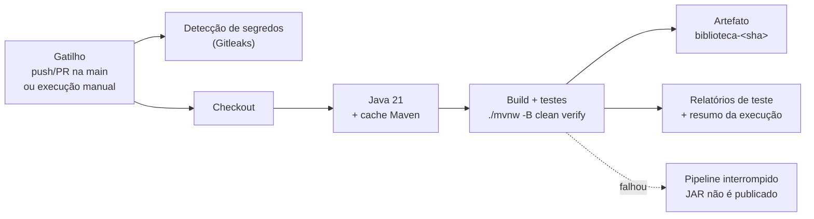
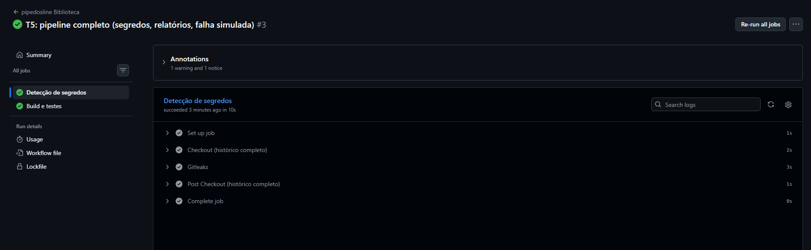
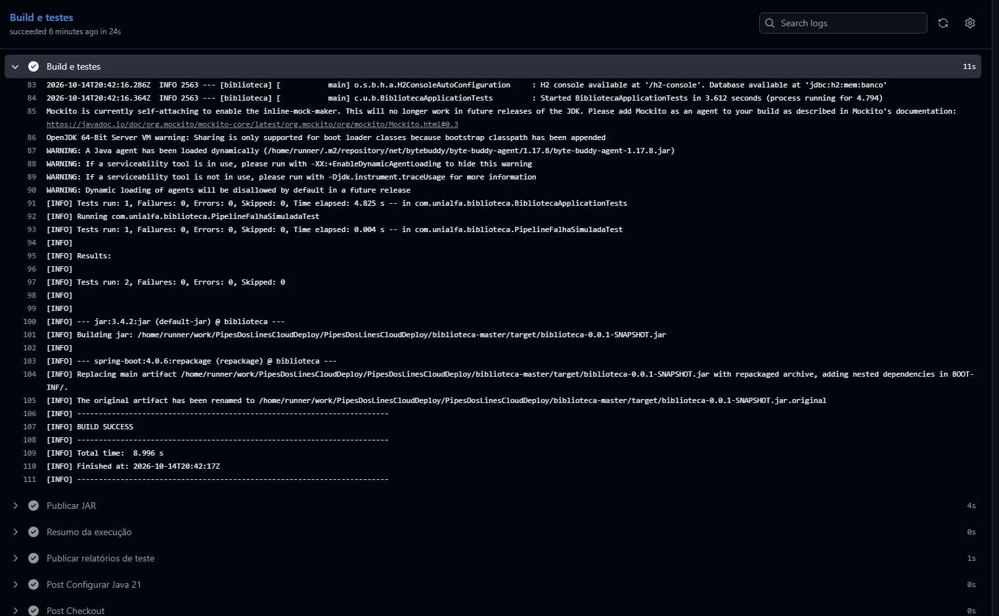
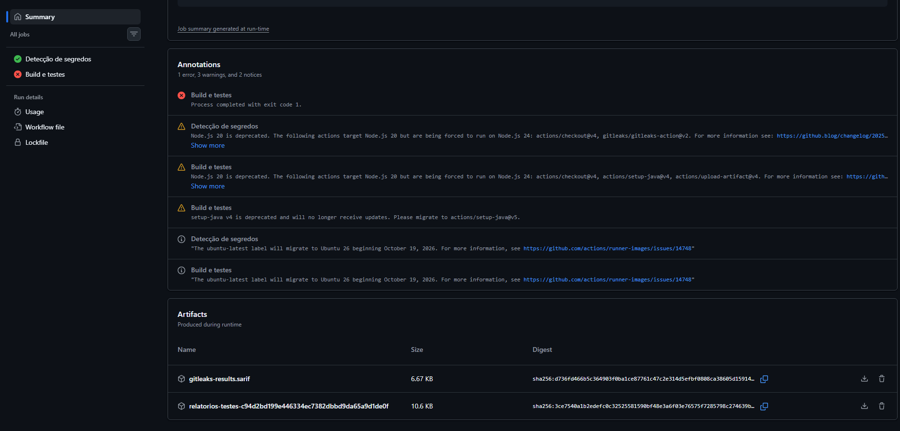
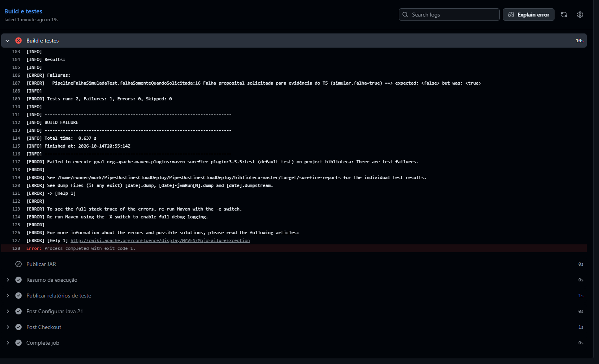

# T5 — Pipeline CI mínimo e reprodutível

**Disciplina:** Cloud Computing e DevOps Avançado
**Aplicação:** Biblioteca (Spring Boot / Java 21 / Maven)
**Ferramenta:** GitHub Actions
**Equipe:** Keltton, Felipe, Daniel
**Repositório:** https://github.com/Keltton/PipesDosLinesCloudDeploy

---

## 1. Visão geral



Arquivo do pipeline: [`.github/workflows/pipedosline.yml`](.github/workflows/pipedosline.yml)
A aplicação fica em `biblioteca-master/` (usada como `working-directory`).

## 2. Definição

| Item | Definição |
|---|---|
| **Gatilho** | `push` na `main`, `pull_request` para a `main` e `workflow_dispatch` (execução manual, com opção de simular falha) |
| **Ambiente** | `ubuntu-latest`, máquina nova e limpa a cada execução |
| **Dependências** | Java 21 (Temurin), Maven Wrapper (`mvnw`) com cache do Maven; actions `checkout@v4`, `setup-java@v4`, `upload-artifact@v4`, `gitleaks-action@v2` |
| **Artefato** | JAR publicado como `biblioteca-<sha do commit>` (retenção de 14 dias) |
| **Evidências geradas** | Log de cada etapa, resumo da execução (Job Summary) e relatórios do Surefire (`relatorios-testes-<sha>`) |
| **Permissões** | `contents: read` e `pull-requests: read` (somente leitura) |

## 3. Etapas

| # | Job | Etapa | Ação | Saída | Falha quando |
|---|---|---|---|---|---|
| 1 | build | Checkout | Baixa o código do commit | Código-fonte | Repositório inacessível |
| 2 | build | Configurar Java 21 | Instala o JDK e restaura o cache do Maven | Ambiente pronto | Versão indisponível |
| 3 | build | Build e testes | `./mvnw -B clean verify`: compila, testa e empacota | `target/*.jar` | Erro de compilação ou teste reprovado |
| 4 | build | Publicar JAR | Envia o JAR para *Artifacts* | `biblioteca-<sha>` | JAR não encontrado |
| 5 | build | Resumo da execução | Escreve commit, gatilho, run e resultado dos testes no Job Summary (sempre executa) | Resumo na página do run | — |
| 6 | build | Publicar relatórios de teste | Envia `surefire-reports` (sempre executa) | `relatorios-testes-<sha>` | — |
| 7 | secrets-scan | Gitleaks | Varre o histórico do repositório em busca de segredos | Resultado do scan | Segredo detectado |

Se a etapa 3 falhar, a etapa 4 não é executada e nenhum JAR é publicado; as etapas 5 e 6 ainda rodam para preservar a evidência.

**Testes existentes:**
- `BibliotecaApplicationTests.contextLoads()` — sobe o contexto Spring.
- `PipelineFalhaSimuladaTest` — passa normalmente; falha apenas quando a execução manual é feita com a opção **simular_falha** marcada (`-Dsimular.falha=true`). Serve para demonstrar a detecção de falha sem alterar o código.

## 4. Como reproduzir

**No GitHub**
1. Fazer um push na `main` ou abrir um Pull Request para a `main`.
2. Ou ir em **Actions → pipedosline Biblioteca → Run workflow**.
3. Acompanhar a execução. O JAR e os relatórios ficam em **Artifacts**, no fim da página do run; o resumo aparece no topo.

**Localmente (mesmo comando do pipeline)**
```bash
git clone https://github.com/Keltton/PipesDosLinesCloudDeploy.git
cd PipesDosLinesCloudDeploy/biblioteca-master
./mvnw -B clean verify            # esperado: BUILD SUCCESS
ls target/*.jar
./mvnw -B clean verify -Dsimular.falha=true   # esperado: BUILD FAILURE
```

## 5. Evidências

### 5.1 Execução bem-sucedida

- Link da execução: `COLAR_URL_DO_RUN_VERDE`
- Commit: `COLAR_SHA` — Gatilho: `push` na `main`


*Jobs `Build e testes` e `Detecção de segredos` concluídos com sucesso.*


*Log de "Build e testes" com `Tests run: 2, Failures: 0, Errors: 0` e `BUILD SUCCESS`.*


*Artefatos `biblioteca-<sha>` e `relatorios-testes-<sha>` em Artifacts.*

### 5.2 Falha detectada

- Cenário: execução manual (**Run workflow**) com a opção `simular_falha` marcada.
- Link da execução: `COLAR_URL_DO_RUN_VERMELHO`


*Etapa "Build e testes" em vermelho; "Publicar JAR" ignorada (skipped); "Resumo" e "Relatórios" ainda executados.*


*Log mostrando `PipelineFalhaSimuladaTest` reprovado e `BUILD FAILURE`.*

Resultado: pipeline interrompido na etapa 3, nenhum JAR publicado. Nova execução sem a opção marcada voltou a ficar verde (link: `COLAR_URL_DO_RUN_CORRIGIDO`).

## 6. Como investigar falhas

1. Abrir **Actions** e localizar a execução com ❌.
2. Abrir o job que falhou e expandir a etapa vermelha.
3. Em falha de teste, procurar no log por `Tests run:` e `FAILURE` para achar a classe e o método.
4. Conferir o **Resumo da execução** (topo da página do run) e baixar `relatorios-testes-<sha>` em Artifacts.
5. Reproduzir localmente: `cd biblioteca-master && ./mvnw -B clean verify`.
6. Corrigir, fazer novo push e confirmar que o pipeline volta a ficar verde.

## 7. Como os segredos são protegidos

- O pipeline roda com permissões somente leitura e não usa tokens de deploy.
- Segredos de pipeline, quando necessários, ficam em **Settings → Secrets and variables → Actions** e são lidos com `${{ secrets.NOME }}`; o GitHub mascara os valores nos logs.
- O job **Detecção de segredos** (Gitleaks) varre todo o histórico a cada execução e reprova o pipeline se encontrar credenciais.
- O valor de `api.security.token.secret` em `application.properties` é apenas de desenvolvimento (banco H2 em memória) e está explicitamente liberado em `.gitleaks.toml`. Em ambiente real ele deve ser sobrescrito pela variável de ambiente `API_SECURITY_TOKEN_SECRET`.
- O Maven Wrapper (`mvnw`) garante a mesma versão do Maven em qualquer máquina.
