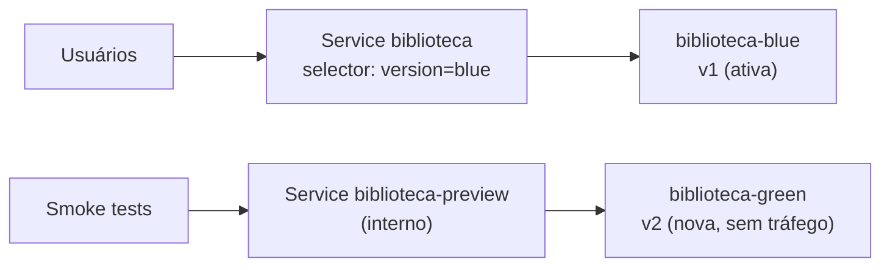
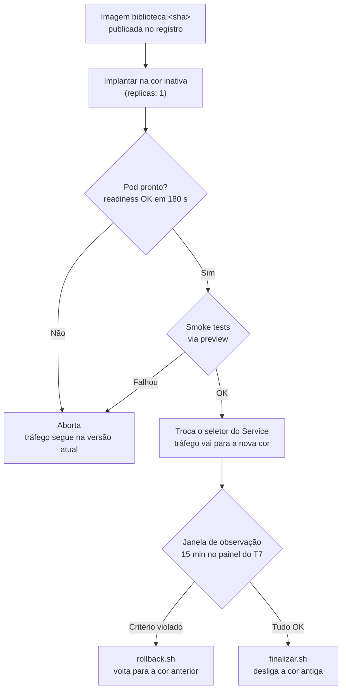

# T6 — Estratégia de CD: deploy e rollback

**Disciplina:** Cloud Computing e DevOps Avançado (Prof. Ranghetti)
**Aplicação:** Biblioteca (Spring Boot 4.0.6 · Java 21) em Kubernetes
**Equipe:** Keltton, Felipe, Daniel

---

## 1. Contexto

| Item | Situação atual | Impacto na estratégia |
|---|---|---|
| Artefato | Imagem identificada pelo commit (ver 1.1) | Permite promover e voltar para uma versão exata |
| Execução | Kubernetes (EKS, GKE, AKS ou K3s, como no T3) | Recursos nativos (`Deployment` + `Service`) bastam |
| Banco | **H2 em memória**, dentro do processo | Só pode haver **1 réplica**; cada pod tem seus próprios dados |
| Sessão web | Login por formulário, sessão em memória | Na troca de versão, o usuário precisa entrar de novo |

### 1.1 Pré-requisito: imagem publicada
O pipeline do T5 gera o JAR. Para o deploy, é preciso a **imagem** no registro, com a tag do commit:

```bash
# Login no GHCR com um token pessoal (escopo write:packages)
echo "$GHCR_TOKEN" | docker login ghcr.io -u keltton --password-stdin

SHA=$(git rev-parse --short HEAD)
docker build -t ghcr.io/keltton/biblioteca:$SHA biblioteca-master
docker push ghcr.io/keltton/biblioteca:$SHA
```

Para automatizar, basta acrescentar ao workflow do T5 um job de imagem que rode depois do build e dos testes.

## 2. Estratégia escolhida: Blue/Green

Existem duas cópias da aplicação, **blue** e **green**. Só uma recebe tráfego por vez, e a troca é feita mudando o seletor do `Service`.



### Por que blue/green e não canary ou rolling update

| Critério | Blue/Green | Canary | Rolling update |
|---|---|---|---|
| Funciona com 1 réplica e H2 em memória | ✅ Uma versão por vez | ❌ Exige 2+ réplicas; cada uma teria um banco diferente e o usuário veria dados distintos a cada requisição | ⚠️ Funciona, mas sem teste antes do tráfego |
| Testar a nova versão antes de liberar | ✅ Pelo `biblioteca-preview` | ✅ Com parte do tráfego real | ❌ |
| Tempo de rollback | ✅ Segundos (troca de seletor; a versão anterior continua ligada) | ✅ Segundos | ⚠️ Minutos (novo rollout) |
| Ferramentas extras | ✅ Nenhuma (`kubectl`) | ❌ Service mesh ou Ingress com divisão de peso | ✅ Nenhuma |
| Custo | ⚠️ 2 pods durante a janela de observação | ⚠️ Réplicas extras | ✅ Menor |

**Justificativa de negócio:** o rollback em segundos limita o tempo de impacto de uma versão com defeito. O custo extra é um segundo pod por cerca de 15 minutos a cada deploy, o que é desprezível perto do custo de deixar uma versão quebrada no ar.

**Canary fica como evolução** para quando a aplicação usar um banco externo (por exemplo, PostgreSQL gerenciado) e tiver várias réplicas.

## 3. Arquivos

| Arquivo | Função |
|---|---|
| `k8s/deployment-blue.yaml` / `k8s/deployment-green.yaml` | As duas cores, com a mesma definição: probes, recursos, Secret e anotações de métricas |
| `k8s/service.yaml` | Service público; o seletor `version` define a cor ativa |
| `k8s/service-preview.yaml` | Service interno (ClusterIP) apontando para a cor inativa |
| `scripts/deploy-bluegreen.sh` | Implanta na cor inativa, roda os smoke tests e troca o tráfego |
| `scripts/rollback.sh` | Devolve o tráfego para a cor anterior |
| `scripts/finalizar.sh` | Desliga a cor antiga depois da janela de observação |

## 4. Fluxo de deploy



**Comandos**
```bash
# Primeira vez: as duas cores começam desligadas (replicas: 0); o primeiro deploy liga a green
# Fork: trocar keltton pelo seu usuário antes (ver Pré-requisitos no README)
kubectl create secret generic biblioteca-secret --from-literal=jwt-secret="$(openssl rand -base64 48)"
kubectl apply -f k8s/

# Cada nova versão
./scripts/deploy-bluegreen.sh <sha>   # imagem padrão: ghcr.io/keltton/biblioteca
./scripts/finalizar.sh      # após 15 min sem problemas
./scripts/rollback.sh       # se algum critério falhar
```

**Aprovação:** o deploy é disparado manualmente por um integrante, depois que o CI do T5 aprovou a imagem. Isso caracteriza **entrega contínua** (Aula 09, slide 29): o artefato está sempre pronto, e a promoção para produção é uma decisão explícita. Uma evolução possível é um workflow com `environment: producao` e aprovação obrigatória no GitHub.

## 5. Critérios de sucesso

### 5.1 Antes da troca (automáticos, no script)
Se qualquer um falhar, o script **aborta** e o tráfego continua na versão atual.

| # | Verificação | Esperado |
|---|---|---|
| 1 | `kubectl rollout status` | Pod pronto em até 180 s |
| 2 | `GET /actuator/health/readiness` (porta 8081) | HTTP 200 |
| 3 | `GET /login` | HTTP 200 |
| 4 | `POST /api/auth/login` com usuário de teste | Retorna um token JWT |
| 5 | `GET /api/livros` com o token | HTTP 200 ou 404 (lista vazia); nunca 401/403, que indicariam JWT recusado |

### 5.2 Depois da troca (janela de observação de 15 min)
Acompanhados no painel do T7. Os limites são os mesmos SLOs do T7.

| Indicador | Sucesso | Gatilho de rollback |
|---|---|---|
| Disponibilidade (requisições sem 5xx) | ≥ 99,5% | < 99,5%, ou alerta `BibliotecaErrosQueimaRapida` |
| Latência p95 | < 500 ms | ≥ 500 ms por mais de 5 min |
| Status do pod | `up = 1`, 0 reinícios | Alerta `BibliotecaIndisponivel` ou `BibliotecaReiniciando` |
| Funcional | Login web e cadastro de livro funcionam | Qualquer falha em fluxo principal relatada |

O deploy é considerado **concluído** quando a janela termina sem gatilhos e o `finalizar.sh` é executado.

## 6. Plano de rollback

### 6.1 Quando acionar
- Qualquer gatilho da seção 5.2.
- Decisão manual do responsável pelo deploy, sem necessidade de diagnóstico prévio. **Primeiro volta, depois investiga.**

### 6.2 Como executar

| Situação | Ação | Tempo estimado (RTO) |
|---|---|---|
| Dentro da janela (cor anterior ainda ligada) | `./scripts/rollback.sh`: só troca o seletor do Service | **< 30 s** |
| Depois do `finalizar.sh` (cor anterior desligada) | O mesmo `./scripts/rollback.sh`: religa a cor anterior, espera ficar pronta e troca | **≈ 2 min** (tempo de subida do Spring Boot) |
| Imagem anterior não está mais em nenhuma cor | `./scripts/deploy-bluegreen.sh <sha-anterior>`: a tag do GHCR (T5) identifica a última versão boa | **≈ 3 min** |
| Primeiro deploy (não existe versão anterior) | O `rollback.sh` recusa e avisa; corrigir e fazer um novo deploy | — |

### 6.3 Depois do rollback
1. Confirmar no painel: requisições voltaram para a cor anterior e erros caíram.
2. **Não desligar** a cor com problema: os logs ficam disponíveis com `kubectl logs deployment/biblioteca-<cor>`.
3. Registrar o incidente: versão, horário, gatilho, impacto e causa.
4. Corrigir, passar pelo CI de novo e repetir o deploy.

### 6.4 Limitações conhecidas

| Limitação | Consequência | Mitigação futura |
|---|---|---|
| H2 em memória | **Dados cadastrados se perdem** em toda troca de versão, inclusive no rollback | Banco externo gerenciado (RDS, Cloud SQL ou Azure SQL) |
| Sessão em memória | Usuários da web precisam entrar de novo após a troca | Sessão externa (Spring Session + Redis) ou só JWT |
| Mudanças de esquema do banco | Com banco externo, as duas cores precisam ser compatíveis com o mesmo esquema | Migrações compatíveis com a versão anterior (expand/contract) |

## 7. Evidências para a entrega

Prints em `docs/evidencias/`. Para os gráficos (itens 4 e 5), o Prometheus/Grafana do T7 coleta os pods do Kubernetes:

```bash
# Terminal A (deixar rodando): expõe as métricas dos pods blue/green em localhost:18081 e :18082
./scripts/port-forward-metricas.sh

# Terminal B: Prometheus + Grafana apontando para o cluster (derrubar antes o compose normal: docker compose down)
cd monitoring && docker compose -f docker-compose.k8s.yml up -d

# Terminal C (deixar rodando durante os deploys): tráfego pelo Service do cluster (porta 80 no Docker Desktop)
URL=http://localhost ./scripts/gerar-trafego.sh normal
```

O gráfico **Requisições por versão** usa o rótulo `version`, que vem de `APP_VERSION` (a tag da imagem): v1 e v2 aparecem como séries diferentes.

| # | Arquivo | Comando / tela | Deve mostrar |
|---|---|---|---|
| 1 | `t6-1-estado-inicial.png` | `kubectl get deploy,svc` | Depois do deploy da v1 e antes do da v2: uma cor com 1 réplica, a outra com 0, e o Service `biblioteca` apontando para a cor ativa |
| 2 | `t6-2-deploy-v1.png` | `./scripts/deploy-bluegreen.sh v1` | Smoke tests `ok:` e a troca de tráfego |
| 3 | `t6-3-deploy-v2.png` | `./scripts/deploy-bluegreen.sh v2` | "Smoke tests OK" e a troca para a outra cor |
| 4 | `t6-4-grafana-troca.png` | Grafana → painel **Requisições por versão** | O tráfego passando de v1 para v2 |
| 5 | `t6-5-rollback.png` | `./scripts/rollback.sh` + painel | Saída do rollback e o gráfico voltando para v1 |
| 6 | `t6-6-service-yaml.png` | `kubectl get svc biblioteca -o yaml` | `selector.version` e a anotação `bluegreen/previous-color` |


