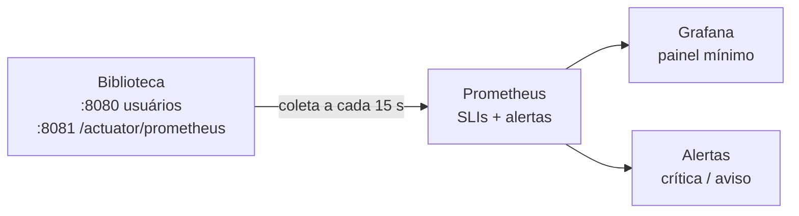

# T7 — Observabilidade: SLIs, SLOs, alertas e painel mínimo

**Disciplina:** Cloud Computing e DevOps Avançado (Prof. Ranghetti)
**Aplicação:** Biblioteca (Spring Boot 4.0.6 · Java 21)
**Ferramentas:** Spring Boot Actuator + Micrometer, Prometheus e Grafana
**Equipe:** Keltton, Felipe, Daniel

---

## 1. Visão geral



| Decisão | Justificativa |
|---|---|
| **Actuator + Micrometer** | Já fazem parte do ecossistema Spring Boot; expõem métricas HTTP e da JVM sem escrever código de instrumentação |
| **Prometheus + Grafana** | Open source e sem custo de licença; funcionam igual em EKS, GKE, AKS e K3s (os ambientes do T3), o que evita lock-in |
| **Métricas na porta 8081** | O `/actuator` não sai pelo Service público (8080); só o Prometheus, dentro do cluster, enxerga |
| **Rótulo `version` nas métricas** | Liga a observabilidade ao deploy blue/green do T6: o painel mostra qual versão está atendendo |

## 2. Alterações na aplicação

| Arquivo | Mudança |
|---|---|
| `biblioteca-master/pom.xml` | + `spring-boot-starter-actuator` e `micrometer-registry-prometheus` |
| `biblioteca-master/src/main/resources/application.properties` | Porta de gestão 8081, endpoints `health`, `info` e `prometheus`, probes do Kubernetes, rótulos `application` e `version`, histograma de latência |
| `biblioteca-master/src/main/java/.../config/SecurityConfiguration.java` | Libera `/actuator/health/**` e `/actuator/prometheus` sem login |

Com isso, as probes do Kubernetes (T6) passam a usar `/actuator/health/readiness` e `/actuator/health/liveness`, que refletem o estado real da aplicação, em vez de `/login`.

## 3. SLIs e SLOs

**SLI** é o que se mede. **SLO** é a meta para essa medida.

| SLI | Como é medido (PromQL) | SLO (30 dias) | Por que importa |
|---|---|---|---|
| **Disponibilidade** | Requisições sem 5xx ÷ total de requisições (sem `/actuator`) | **≥ 99,5%** | É o que o usuário percebe: a página abre ou dá erro |
| **Latência** | p95 de `http_server_requests_seconds` | **95% das requisições < 500 ms** | Acima disso a navegação parece travada |

### Por que 99,5% e não 99,9%
- A arquitetura tem **1 réplica** (limitação do H2 em memória), então cada deploy ou reinício gera alguns segundos fora do ar.
- 99,5% dá um **orçamento de erro de 0,5%**, cerca de **3 h 36 min por mês**. Isso comporta os deploys do T6 e incidentes pequenos.
- 99,9% (43 min/mês) exigiria várias réplicas e banco externo, ou seja, mais custo. Uma meta que a arquitetura não sustenta só gera alertas que ninguém resolve.

### Sinais de apoio (sem SLO, usados para diagnóstico)

| Sinal | Métrica | Uso |
|---|---|---|
| Saturação de memória | `jvm_memory_used_bytes` ÷ `jvm_memory_max_bytes` (heap) | Antecipa OutOfMemory e reinício do pod |
| Tráfego | Requisições por segundo, por endpoint e status | Mostra qual rota gera erro |
| Disponibilidade da coleta | `up{job="biblioteca"}` | Detecta aplicação fora do ar |
| Reinícios | `kube_pod_container_status_restarts_total` | Detecta crash loop (só no Kubernetes) |

## 4. Alertas

Arquivo: `monitoring/alert-rules.yml`

| Alerta | Condição | Duração | Severidade | Ação esperada |
|---|---|---|---|---|
| `BibliotecaIndisponivel` | Nenhum alvo com `up == 1` (a cor inativa no K8s não conta) | 2 min | 🔴 Crítica | Ver pod, readiness e último deploy |
| `BibliotecaErrosQueimaRapida` | Erro 5xx > **7,2%** em 1 h **e** em 5 min | 2 min | 🔴 Crítica | Se houve deploy recente: `scripts/rollback.sh` (T6) |
| `BibliotecaErrosQueimaLenta` | Erro 5xx > **3%** em 6 h **e** em 30 min | 15 min | 🟡 Aviso | Investigar logs e endpoints no painel |
| `BibliotecaLatenciaAlta` | p95 > 500 ms | 10 min | 🟡 Aviso | Ver CPU, heap e consultas lentas |
| `BibliotecaMemoriaAlta` | Heap > 85% | 10 min | 🟡 Aviso | Avaliar aumentar o limit de memória |
| `BibliotecaReiniciando` | Mais de 2 reinícios em 15 min | — | 🟡 Aviso | `kubectl describe pod` e `logs --previous` |

### Por que alertar por "queima do orçamento" e não por um limite fixo
Os limites de erro vêm do SLO, não de um número escolhido no chute:

| Alerta | Fator de queima | Significado |
|---|---|---|
| Queima rápida | 14,4 × 0,5% = **7,2%** | Nesse ritmo, 2% do orçamento do mês some em 1 hora e ele acaba em ~2 dias |
| Queima lenta | 6 × 0,5% = **3%** | Nesse ritmo, 5% do orçamento some em 6 horas |

Exigir **duas janelas** ao mesmo tempo (uma longa e uma curta) evita alarme falso por um pico de segundos e faz o alerta parar logo depois que o problema é corrigido. É o método recomendado pelo *Google SRE Workbook*.

**Princípio aplicado (Aula 09, slide 45):** cada alerta tem uma ação possível. Não há alerta só informativo.

## 5. Painel mínimo

Arquivo: `monitoring/grafana/dashboards/biblioteca.json` (carregado automaticamente no Grafana, pasta **T7**)

| Linha | Painel | O que mostra |
|---|---|---|
| Resumo | **Status** | NO AR / FORA |
| | **Disponibilidade (1h)** | SLI atual; fica vermelho abaixo de 99,5% |
| | **Latência p95** | SLI atual; fica vermelho acima de 500 ms |
| | **Heap JVM** | Uso de memória |
| | **Requisições/s** | Tráfego atual |
| Detalhe | **Taxa de erro 5xx** | Série temporal com a linha do alerta de 7,2% |
| | **Latência por percentil** | p50, p95 e p99, com a linha do SLO |
| | **Requisições por versão** | Troca de tráfego blue → green do T6 |
| | **Requisições por endpoint e status** | Qual rota está falhando |

A primeira linha responde "está tudo bem?" em 5 segundos. A segunda responde "o que está errado?".

## 6. Como reproduzir (local, sem custo de nuvem)

Pré-requisito: Docker com Docker Compose.

```bash
cd monitoring
export API_SECURITY_TOKEN_SECRET="$(openssl rand -base64 48)"
docker compose up -d --build
```

| Serviço | Endereço |
|---|---|
| Biblioteca | http://localhost:8080/login (admin / admin) |
| Prometheus | http://localhost:9090 (aba **Alerts**) |
| Grafana | http://localhost:3000 → Dashboards → T7 |

**Gerar tráfego** (em outro terminal, na raiz do repositório):
```bash
./scripts/gerar-trafego.sh normal
```

**Contra os pods do Kubernetes (T6):** `./scripts/port-forward-metricas.sh` em um terminal e, em `monitoring/`, `docker compose -f docker-compose.k8s.yml up -d` (derrubar antes o compose normal). O tráfego pelo Service do cluster é gerado com `URL=http://localhost ./scripts/gerar-trafego.sh normal` (porta 80 no Docker Desktop).

**Em um cluster com kube-prometheus-stack:** os pods já têm as anotações `prometheus.io/scrape`, `port` e `path`. Com o *kube-prometheus-stack* instalado, basta um `PodMonitor` apontando para a porta `management`, e o arquivo `alert-rules.yml` vira um `PrometheusRule`. O rótulo `job` deve ser `biblioteca` para as consultas funcionarem.

## 7. Evidências para a entrega

Prints em `docs/evidencias/`, com o compose normal (`monitoring/docker-compose.yml`).

| # | Arquivo | Onde | Deve mostrar |
|---|---|---|---|
| 1 | `t7-1-target-up.png` | Prometheus → **Status → Targets** | `biblioteca` em **UP** |
| 2 | `t7-2-painel-normal.png` | Grafana → Dashboards → T7 | Os 9 painéis com tráfego normal (`./scripts/gerar-trafego.sh normal`) |
| 3 | `t7-3-porta-8081-fechada.png` | Terminal: `curl http://localhost:8081/actuator/prometheus` | **Conexão recusada**: a porta de métricas não está publicada fora da rede interna |
| 4 | `t7-4-alerta-firing.png` | Prometheus → **Alerts** | `BibliotecaIndisponivel` em **FIRING** (~2 min depois de `docker compose stop biblioteca`) |
| 5 | `t7-5-painel-fora.png` | Grafana | Painel **Status = FORA** |
| 6 | `t7-6-recuperacao.png` | Prometheus → **Alerts** | Alerta inativo depois de `docker compose start biblioteca` |


### Complemento opcional: taxa de erro
```bash
./scripts/gerar-trafego.sh erro    # aguardar ~5 min
```
- `t7-7-erro-5xx.png`: gráfico de erro 5xx acima da linha de 7,2% e `BibliotecaErrosQueimaRapida` em **PENDING/FIRING**
- `t7-8-erro-endpoint.png`: painel "por endpoint" com `/api/livros/{id}` em status 500

Se o painel não registrar status 500 nesse teste, a evidência de indisponibilidade (itens 4 a 6) não depende do comportamento da aplicação.

## 8. Achado durante o trabalho
`GET /api/livros/{id}` com um id inexistente responde **500**, porque `LivroService` usa `Optional.get()`. O correto seria **404**. Hoje esse erro conta contra o SLO de disponibilidade, embora a culpa seja do cliente. A correção recomendada é usar `orElseThrow` com `ResponseStatusException(HttpStatus.NOT_FOUND)`. Ela não foi aplicada aqui porque o script de erro do item 7.2 depende desse comportamento.
